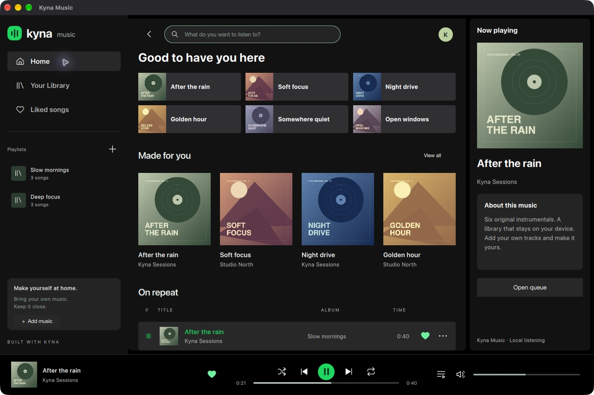

# Kyna Music

A native desktop music player built with the **Kyna language**. Search your local music, create playlists, like tracks, queue songs, shuffle, repeat, seek and control volume. Six original instrumentals are included so the application works immediately.

The desktop layout studies Spotify's library, album grids, now-playing panel and fixed transport. Kyna Music is independent; it does not connect to Spotify or include its commercial recordings.



[Library and queue](docs/screenshots/library-queue-macos.png) · [Search](docs/screenshots/search-macos.png) · [Compact layout](docs/screenshots/compact-macos.png) · [Working app video](docs/videos/kyna-music-macos.mp4)

## Run and build

Requirements: Python 3.10+, CMake 3.25+, a C++20 compiler, Qt 6.8+ with Quick, Quick Controls and Multimedia, and [Kyna](https://github.com/qentrah/Kyna). The pinned CI checkout is `9d33bfb898f3e8261a2a2dde7e8cc579bb54092d` (native ABI 2).

```bash
python tools/build.py build --kyna-root ../Kyna --ky ../Kyna/build-native/bin/ky --qt-prefix /opt/homebrew
python tools/build.py test --kyna-root ../Kyna --ky ../Kyna/build-native/bin/ky
python tools/build.py run --kyna-root ../Kyna --ky ../Kyna/build-native/bin/ky
python tools/build.py package --kyna-root ../Kyna --ky ../Kyna/build-native/bin/ky
```

On macOS install build dependencies with `brew install cmake qtbase qtdeclarative qtmultimedia qtsvg`. On Windows use MSVC and Qt's matching MSVC kit; on Linux use Qt's GCC kit, an audio server and `patchelf` for packaging. The GitHub workflow builds the language and application from source on each platform. Windows/macOS/Linux artifacts are verified only when that platform's application tests pass.

Use the layout button beside the search field (or Ctrl+Shift+L) to switch between compact and wide windows; the toggle is handled in Kyna.

`tools/build.py` automates configure, compile, Kyna checking, application tests and portable packaging. Packaging runs **`ky build main.ky`**, copies the checked Kyna modules and includes the native runtime closure with SHA-256 inventories. Recipients do not need a compiler or Qt SDK. Local macOS packages are ad-hoc signed, not notarized.

## What is written in Kyna?

| Part | Owner |
|---|---|
| Entry point and app icon | `main.ky` |
| Navigation, search, likes, playlists, queue, shuffle, repeat and playback decisions | `src/app.ky` |
| Application behavior tests, callback/GC checks and persistence assertions | `tests/*.ky` |
| Declarative native layout and accessible controls | `ui/*.qml` |
| Audio, file picker integration, atomic storage and typed native exports | `native/src/` C++ adapter |
| Build orchestration and original demo generation | `tools/` Python |

Kyna remains the application language; Qt provides native presentation and audio through ABI 2. JSON is an explicit `any` boundary in the application state; native persistence validates its schema. It is not a web view or an Electron application.

Change the app icon from Kyna:

```kyna
musicIcon(":/music/ui/icons/app.svg");
# Or supply a readable local PNG/SVG file.
```

Read the [step-by-step Kyna build tour](docs/build-tour.md). See [architecture and bindings](docs/architecture.md), [visual references](docs/references.md), and [verification](docs/verification.md).

## Files and privacy

Import local audio with **Add music**. Original files stay in place. Library metadata is saved atomically in the operating system's application-data folder; `KYNA_MUSIC_DATA_DIR` overrides it for tests. Moving a file produces an actionable playback error. Codec availability depends on the packaged Qt backend. Imported titles use filenames (`Artist - Song` is recognized); embedded tags and network streaming are not implemented.

## License

Application source: MIT. Original demonstration audio, covers and icons: CC0. Qt and its dependencies retain their own licenses. Packages include dependency inventories and notices. See `LICENSE` and `LICENSE-ASSETS.txt`.
