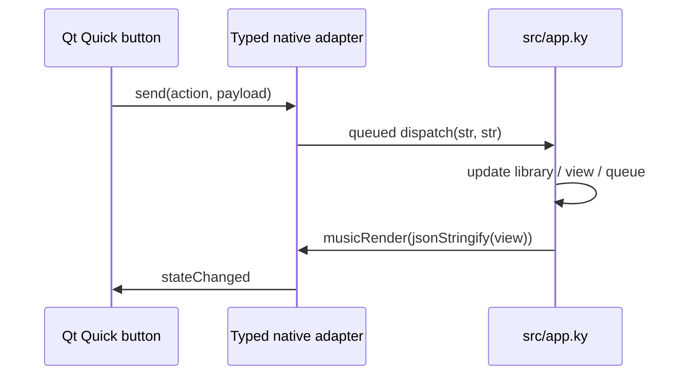

# Build a native desktop app with Kyna

Kyna Music is a complete example of the existing C++ compiler and bytecode VM driving a native application. The app's decisions live in Kyna. Qt Quick draws the interface and Qt Multimedia handles audio through a small typed C ABI adapter.

## 1. Start in Kyna

`main.ky` is the application entry point:

```kyna
import { initialize } from "./src/app.ky";
initialize();
musicIcon(":/music/ui/icons/app.svg");
collectGarbage();
musicRun();
```

`initialize()` loads the library, sets the initial view and registers `dispatch`, a typed `fn(str, str): void` callback. `musicRun()` enters the native UI loop. Calling GC before the loop deliberately exercises callback retention: the native subscription must keep the Kyna handler alive.

## 2. Follow one interaction



For search, Kyna normalizes the query with `textLower`, filters title/artist/album using `textContains`, and returns the visible track collection. For play-all, Kyna starts the first visible track and fills its queue with the rest. Qt does not make these decisions.

The JSON view is an explicit `any` boundary. Exported native functions still have checked signatures, and persisted records receive bounded schema validation in the adapter. Replacing the view with a fully typed record model is future work; the current example does not pretend that JSON fields are statically checked.

## 3. Change the presentation or icon

- `ui/Main.qml`: sidebar, home view, collection/search table, queue and responsive columns.
- `ui/AlbumCard.qml` and `ui/TrackRow.qml`: repeatable album and song presentation.
- `ui/PlayerBar.qml`: playback controls and seek/volume sliders.
- `ui/IconButton.qml`: accessible icon controls and keyboard focus.
- `ui/icons/app.svg`: the original Kyna Music icon selected from Kyna and rendered into desktop package formats.

Change `musicIcon(...)` to select a runtime image. To change the shipped launcher icon, replace the source SVG and rebuild; packaging generates macOS ICNS, Windows ICO and a Linux PNG. A runtime icon call alone cannot edit an already packaged executable.

The layout toggle dispatches `compact` to Kyna, which updates `view.compact`. The view switches window size and collapses the right panel below 1200 pixels. The screenshots show both configurations.

## 4. Compile, check, test, package

Install the platform prerequisites in the root README and build the pinned Kyna revision using [Kyna's build guide](https://github.com/qentrah/Kyna#readme). Then run from this repository:

```sh
python tools/build.py build --kyna-root ../Kyna --ky ../Kyna/build-native/bin/ky
python tools/build.py check --kyna-root ../Kyna --ky ../Kyna/build-native/bin/ky
python tools/build.py test --kyna-root ../Kyna --ky ../Kyna/build-native/bin/ky
python tools/build.py package --kyna-root ../Kyna --ky ../Kyna/build-native/bin/ky --output build/delivery
python tools/verify_package.py build/delivery
```

Pass `--qt-prefix` if CMake cannot find Qt. On Windows, pass the actual `ky.exe` path (a multi-configuration CMake build normally uses `build/bin/Release/ky.exe`). Linux GUI testing requires a display/audio server; CI supplies Xvfb and a PulseAudio null sink. Package output must be a fresh directory.

`build` compiles the C++ adapter and launchers, then type-checks the Kyna entry point against the adapter's ABI descriptor. `test` runs Kyna behavior tests against real playback and persistence. `package` runs `ky build`, stages the runtime and Qt dependency closure, records hashes and notices, and creates the desktop archive. The final command reruns the app from that bundle with SDK search paths removed.

The [desktop workflow](../.github/workflows/desktop.yml) performs these actions on Windows x86_64, Linux x86_64 and macOS ARM64. A platform is verified only after its application and package smoke tests pass.

## 5. Inspect the result

Recipients extract the entire archive and open `KynaMusic.exe`, `KynaMusic`, or `Kyna Music.app`. The launcher starts the bundled VM with the bundled Kyna entry point and typed adapter. It resolves paths from its own location, so a terminal, source checkout and Qt SDK are unnecessary.

`ARCHIVE-SHA256SUMS` verifies the downloaded archive; `SHA256SUMS` inventories the app files. `BUNDLE-AUDIT.json` records ABI/Qt version and production-signing status. License notices are inside the app; exact Qt source archives accompany the CI artifact. Preview macOS builds use ad-hoc signatures and are not notarized.

See [verification](verification.md) for limitations, [architecture](architecture.md) for ownership, and the [actual app recording](videos/kyna-music-macos.mp4) for playback, navigation and search.
